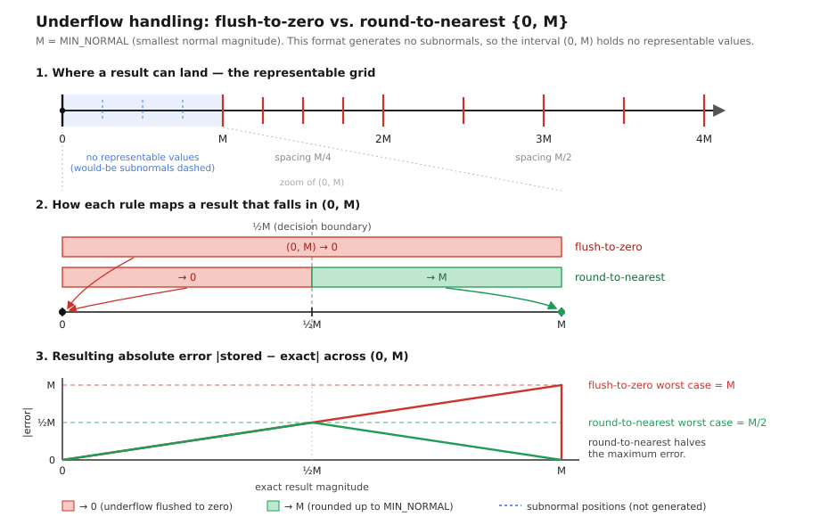
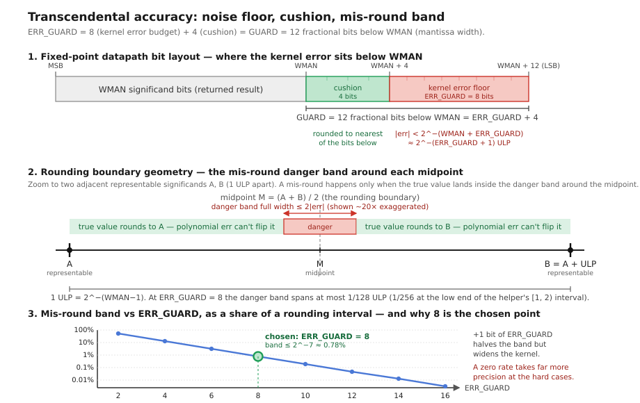

# Zubax Kulibin floating point

[](https://pypi.org/project/zkf/)
[](https://forum.zubax.com)

A small and FPGA-friendly floating point format that is similar to IEEE 754 but intentionally omits support for NaN,
subnormals, exceptions, and rounding modes other than round-to-nearest, ties-to-even (RNTE).
Only one canonical positive zero representation exists.

The bit layout is identical to IEEE 754: sign, exponent, and the significand with the MSb omitted.

See how ZKF beats other floating-point libraries in <https://zubax.github.io/fpga-floating-point-eval>.

## Usage

Install: `pip install zkf`.
ZKF is written in Amaranth and can be integrated into Amaranth designs as well as emit ordinary portable Verilog.

```python
import zkf

mul = zkf.Mul(zkf.ZkfFormat(8, 24), wmultiplier=18, stage_core_mul=2)  # 8b exponent, 24b mantissa, 18b multipliers
mul.timing.latency           # cycles from in_valid to out_valid
verilog = mul.compile()      # generate Verilog source
component = mul.component()  # or the Amaranth component, for an Amaranth design or its simulator
a, b = mul.fmt.encode(1.5), mul.fmt.encode(-2)
mul.evaluate(a, b)           # what the hardware gives for these operands exactly
```

Most operators are zero-bubble throughput-1 pipelines with the conventional `in_valid`/`out_valid` interface;
`zkf.Cordic` is FSM-based and adds the `in_ready`/`out_ready` handshake.
Every operator has a fixed data-independent latency, known from its configuration for each mode (see `.timing`).

The two main parameters are wexp and wman setting the bit width of the biased exponent and the significand;
the most significant bit of the significand is not stored, but there is a sign bit,
so the total bit width is simply `wfull=wexp+wman`.

### Caveats

Some of the simple combinational operators may produce non-canonical outputs (namely, a negative zero);
this however does not affect compatibility with other operators since they always canonicalize inputs.

A Yosys script that runs `opt` after `proc` with no `opt_clean` between them stops at "Conflicting init values" on
some configurations; `attrmap -remove init` before `proc` avoids it, and the registers keep their initial values.
This is mostly a Yosys quirk rather than a library issue.

Read as SystemVerilog (Icarus `-g2012`, which cocotb uses), the printed text needs a reset edge after time zero, or
its valid flags stay unknown; even then the angle of `zkf.Cordic`'s first vectoring is unknown. Read as Verilog-2005,
it shows neither.

### Tuning knobs

Operators can be tuned for the target chip with register-stage knobs, all off by default:

- `stage_input` and `stage_output` -- input and output register stages shielding the operator's internal combinational
paths from external circuits.
When zero, internal combinational paths are exposed directly;
when greater than one, dummy stages are added which helps with retiming or when routing delays dominate.

- `stage_core` -- a set of the operator's own registers, e.g. `zkf.Add.CoreStages.SUM | zkf.Add.CoreStages.PACK`;
operators made of parts take one knob per part, such as the product's `stage_core_mul`.
The docstrings describe the knobs of each operator.

The `timing` property gives the latency and the initiation interval (II) of the chosen staging configuration.

Operators that multiply take `wmultiplier`, the operand width of the target's multipliers (16, 18 and 24 bits are
common in modern FPGAs; in the absence of hard DSP blocks any value will work).

`rom_attrs` and `mul_attrs` pass synthesis attributes to the lookup tables and to the products' operand registers,
e.g. `rom_attrs={"rom_style": "block"}`.

Use `zkf.Pipe` to delay your own control or sideband signals by an operator's latency so they land with its output.

### Catalogue

II - initiation interval (cycles between accepting new inputs; 1 for zero-bubble pipelines).

| Class           | II      | Function                                                                                      | Remarks                     |
|-----------------|---------|-----------------------------------------------------------------------------------------------|-----------------------------|
| `zkf.AbsNeg`    | 1       | Absolute value and negation.                                                                  | Does not canonicalize       |
| `zkf.Finite`    | 1       | Finiteness flag, and ±∞ replaced by the nearest finite value.                                 | Does not canonicalize       |
| `zkf.Cmp`       | 1       | Compare two values; also outputs their min and max.                                           | Does not canonicalize       |
| `zkf.Add`       | 1       | `a + b`, also `a - b` when the sign bit of `b` is flipped.                                    |                             |
| `zkf.Mul`       | 1       | `a⋅b`.                                                                                        |                             |
| `zkf.MulIlog2`  | 1       | `a⋅2^k` for signed integer k (ldexp/scalbn).                                                  |                             |
| `zkf.Ilog2`     | 1       | Raw exponent minus bias; sign-invariant signed integer.                                       | Flags zero, infinity, negative |
| `zkf.Fma`       | 1       | `(a⋅b) + c` fused multiply-add, high precision, rounded once.                                 | Larger than separate mul->add; non-finite handling follows mul->add.|
| `zkf.FromInt`   | 1       | Cast signed two's-complement integer to float.                                                |                             |
| `zkf.Resize`    | 1       | Cast between different float formats.                                                         |                             |
| `zkf.Rint`      | 1       | Round to integer, outputs both a float and a saturated integer.                               | RNTE/floor/ceil/trunc       |
| `zkf.Divsqrt`   | 1       | `a ÷ b` or `√a`; `error` iff /0 or domain error.                                              | Correct rounding, 0.5 ULP   |
| `zkf.Exp2`      | 1       | `2^x`                                                                                         | Faithful rounding, see below|
| `zkf.Log2`      | 1       | `log2(x)`; `domain_error` if `x<0`, `pole` if `x=0`.                                          | Faithful rounding, see below|
| `zkf.Cordic`    | latency | `sin(2π⋅x)`, `cos(2π⋅x)`, `quadrant`; or `atan2(y,x)` in turns ∈ (-0.5,0.5], `hypot(y,x)`.    | Faithful rounding, see below|
| `zkf.Pipe`      | 1       | Delay line of N register stages, W bits each.                                                 | No-op                       |

### Derived functions

The basic modules available enable efficient computation of a large set of derived functions; examples follow.
Bare angle functions follow the usual radian convention; helpers suffixed `_turns` expose ZKF's native turn
representation.

    sin_turns(x), cos_turns(x)  = zkf.Cordic(x)                     ; rotation; x in turns
    atan2_turns(y,x)            = zkf.Cordic(y, x)                  ; vectoring; angle in turns ∈ (-0.5,0.5]
    atan_turns(x)               = atan2_turns(x, 1)

    normalize_angle(x)          = x - 2π⋅floor((x + π) / (2π))      ; [-π,+π)
    normalize_angle_turns(t)    = t - floor(t + 0.5)                ; [-0.5,+0.5)

    INV_TAU = 1 / (2π)
    radians_to_turns(x) = x⋅INV_TAU

    sin(x), cos(x)      = sin_turns(radians_to_turns(x)), cos_turns(radians_to_turns(x))
    atan2(y,x)          = 2π⋅atan2_turns(y, x)

    sqrt(x)             = zkf.Divsqrt(x)        ; correctly rounded 0.5 ULP
    exp(x)              = exp2(x⋅log2(e))
    ln(x)               = log2(x) / log2(e)
    log10(x)            = log2(x) / log2(10)
    log_b(x)            = log2(x) / log2(b)     ; x>0, b>0, b≠1
    pow(a,b)            = exp2(b⋅log2(a))       ; real-valued identity for a>0
    recip(x)            = 1 / x
    rsqrt(x)            = exp2(log2(x)⋅-2^-1)   ; x>0; avoids division
    rsqrt(x)            = sqrt(1 / x)           ; x>0, 1/x normal; faithful, 0.85 ULP max at wman=18
    cbrt(x)             = sign(x)⋅exp2(log2(abs(x)) / 3)

    tan(x)              = sin(x) / cos(x)
    atan(x)             = atan2(x, 1)
    asin(x)             = atan2(x, sqrt(1 - x⋅x))                       ; x ∈ [-1,+1]
    acos(x)             = atan2(sqrt(1 - x⋅x), x)                       ; x ∈ [-1,+1]
    h                   = max(abs(x), abs(y))
    hypot(x,y)          = h⋅sqrt((x/h)⋅(x/h) + (y/h)⋅(y/h))             ; also see zkf.Cordic

    min(a,b), max(a,b)  = zkf.Cmp(a,b)
    clamp(x, lo, hi)    = min(max(x, lo), hi)
    lerp(a,b,t)         = fma(t, b - a, a)
    deadzone(x,d)       = sign(x)⋅max(abs(x) - d, 0)
    smoothstep(t)       = t⋅t⋅(3 - 2⋅t); where t is clamped to [0,1]

    dot(a,b)            = sum_i a[i]⋅b[i]                               ; use zkf.Fma chains
    norm2(x)            = dot(x, x)
    norm(x)             = sqrt(norm2(x))
    normalize(x)        = x⋅rsqrt(norm2(x) + ε)
    distance(a,b)       = norm(a - b)
    distance_2d(a,b)    = hypot(a.x - b.x, a.y - b.y)

    db_power(x)         = 10⋅log10(x)                                   ; x>0
    db_amplitude(x)     = 20⋅log10(abs(x))                              ; x≠0
    power_from_db(x)    = exp2(x⋅log2(10) / 10)
    amp_from_db(x)      = exp2(x⋅log2(10) / 20)

    sinc(x)             = sin(π⋅x) / (π⋅x)                              ; normalized, sinc(0)=1
    rms(x)              = sqrt(mean(x⋅x))
    ema(y,x,a)          = fma(a, x - y, y)

    complex_abs(re,im)  = hypot(re, im)
    arg(re,im)          = atan2(im, re)
    arg_turns(re,im)    = atan2_turns(im, re)
    unit_complex(t)     = (cos(t), sin(t))                              ; principal counterpart of arg()
    polar(r,t)          = (r⋅cos(t), r⋅sin(t))                          ; r≥0
    complex_mul((ar,ai),(br,bi)) = (ar⋅br - ai⋅bi, ar⋅bi + ai⋅br)
    rotate2(x,y,t)      = (x⋅cos(t) - y⋅sin(t), x⋅sin(t) + y⋅cos(t))

    relu(x)             = max(x, 0)
    leaky_relu(x)       = x ≥ 0 ? x : α⋅x
    hard_sigmoid(x)     = clamp(α⋅x + β, 0, 1)
    hard_swish(x)       = x⋅hard_sigmoid(x)

    sigmoid(x)          = 1 / (1 + exp2(-x⋅log2(e)))
    tanh(x)             = 2⋅sigmoid(2⋅x) - 1
    softplus(x)         = max(x, 0) + log2(1 + exp2(-abs(x)⋅log2(e))) / log2(e)
    silu(x)             = x⋅sigmoid(x)

    m                   = max_i x[i]
    logsumexp(x[])      = m + log2(sum_i exp2((x[i] - m)⋅log2(e))) / log2(e)
    softmax_i(x[])      = exp2((x[i] - m)⋅log2(e)) / sum_j exp2((x[j] - m)⋅log2(e))
    layer_norm(x)       = (x - mean(x))⋅rsqrt(var(x) + ε)

And so on.

Generic floating-point remainder/modulo computation is not included because the general solution requires iterative
range reduction which maps poorly onto fixed-latency FPGA cores; instead, one can build the iterative solver using
the existing basic operators: zkf.Fma, zkf.Divsqrt, etc.

## Semantics

Differences from IEEE 754: no NaN, no subnormals (exponent 0 always encodes +0; finite magnitudes in `(0, min_normal/2)`
round to +0; magnitudes in `[min_normal/2, min_normal)` round to signed min_normal), no -0, no exceptions,
overflow produces ±∞.

Infinity cases that would be NaN in IEEE 754:

| Expression          | Result                         |
|---------------------|--------------------------------|
| +∞ + -∞             | +0                             |
| 0⋅±∞                | +0                             |
| 0 ÷ 0               | +0                             |
| ±∞ ÷ ±∞             | +0                             |
| √x; x<0             | -inf                           |

Non-NaN infinity cases (same intent as IEEE 754):

| Expression          | Result                         |
|---------------------|--------------------------------|
| finite≠0 ÷ 0        | ±∞  (sign = sign of dividend)  |
| ±∞ ÷ 0              | ±∞  (sign = sign of dividend)  |
| finite ÷ ±∞         | +0                             |
| ±∞⋅±∞               | ±∞  (sign = signs XOR)         |
| finite≠0⋅±∞         | ±∞  (sign = signs XOR)         |

The subnormal round-to-nearest behavior is illustrated below, compared against the basic flush to zero for any value
below the min normal. The timing/area cost of both approaches is approximately equivalent while the rounding method
halves the worst-case error.

ZKF only has a single canonical zero representation -- the positive zero. However, it is not an error to pass a
negative zero as an operand; the sign bit of a zero operand is simply ignored. This relaxation enables simplification
of certain basic operators.



### Accuracy of the transcendental functions

The exp2 and log2 transcendentals deliver faithful rounding: every finite result is one of the two representable
values bracketing the exact result.

A result differs from round-to-nearest only near a midpoint between adjacent representable values; the measured rate
is near `10^-4`. `zkf.Cordic` carries the same faithful-rounding contract.



**ATTENTION:** the lookup tables of `zkf.Exp2` and `zkf.Log2` must be mapped to ROM; if fabric usage or timing looks
unreasonable, check the synthesis settings first, and if necessary give `rom_attrs`.

## Sizing the exponent and the significand (wexp/wman)

wexp can be chosen freely within an operator's limits, while wman is sensitive to the chip's DSP capabilities and thus
requires careful selection to achieve best resource utilization.

|wman |≈ε (interval)| Description                                                                                 |
|-----|-------------|---------------------------------------------------------------------------------------------|
|  16 | 3.052e-05   | DSP tiles in Lattice iCE40 and similar                                                      |
|  18 | 7.629e-06   | Classic FPGA DSP width, very common: ECP5, PolarFire, Trion, many Intel modes, etc.         |
|  24 | 1.192e-07   | IEEE 754 binary32; also fits Versal DSP58's 27x24 asymmetric multiplier side                |
|  27 | 1.490e-08   | Intel/Altera variable-precision DSPs                                                        |
|  32 | 4.657e-10   | 2x16                                                                                        |
|  36 | 2.910e-11   | 2x18 (very common) or native Intel/Altera 36x36-style variable-precision mode               |
|  48 | 7.105e-15   | 2x24 or 3x16; with an 8-bit exponent amounts to 7 bytes exactly                             |
|  53 | 2.220e-16   | IEEE 754 binary64                                                                           |

Narrower wman is rarely practical for computation due to low precision and fast error accumulation,
although they can still be useful for storage/exchange. One notable exception is neural networks though.

### wman=18

An FPGA-friendly format because modern DSP-enabled FPGAs often implement 18x18 bit multipliers, which means that a
narrower mantissa is unlikely to save much resources or nontrivially improve timings as long as hardware multipliers
are used.

One can stay within 24 bits total by choosing wexp=6:

    wexp=6 wman=18 wfrac=17 wfull=24 bias=31
    lowest     = 1/1073741824 ≈ 9.313e-10
    max        = 0xFFFF_C000  ≈ 4.295e+09
    ε          = 1/131072     ≈ 7.629e-06

### wman=36

Similar to the above, wman=36 is efficient on common FPGAs because it maps multiplication to four 18x18 DSP slices.
This is often a better fit for intermediate result representation to avoid error accumulation --
the precision lands halfway between IEEE 754 binary64 and binary32.

Usually, on an 18x18 DSP chip, going even a single bit higher causes f_max to tank dramatically while area explodes.
Thus this is likely to be the optimal choice for a large number of applications.

Using binary32-compatible exponent wexp=8, 44 bits total (5.5 bytes):

    wexp=8 wman=36 wfrac=35 wfull=44 bias=127
    lowest     = 1/85070591730234615865843651857942052864 ≈ 1.175e-38
    max        = 0xFFFFFFFF_F0000000_00000000_00000000    ≈ 3.403e+38
    ε          = 1/34359738368                            ≈ 2.910e-11

### IEEE 754-like

ZKF offers limited compatibility with IEEE 754 so while it can match the bit layout,
not all states are mappable between the formats.

- wexp=5  wman=11: IEEE 754 binary16-like
- wexp=8  wman=24: IEEE 754 binary32-like
- wexp=11 wman=53: IEEE 754 binary64-like

## TODO

Roughly ordered by severity.

- `cordic` at 8/36 is bound next by the division's digit, a recurrence, by the sum of a product's rows,
  two carry chains in a row, by the rounding into the result, and by the normalizer, whose detects of the later levels
  wait for the shifts ahead of them; the packer's sticky is gathered behind its last shift.
  These sit within about 5% of 100 MHz on the ECP5, about as much as placement moves them. One iteration a cycle
  there closes on neither Yosys nor Diamond.

- `divsqrt` and `cordic`'s division could take a radix-8 SRT digit a stage on a carry-save remainder, behind a `fast`
  knob: two thirds of the digits (`divsqrt` at 8/36: 17 cycles to about 12). Two radix-4 SRT digits a stage, built in
  `cordic` and bit-identical, run at 55 to 89 MHz on the ECP5.

- Transcendental operator refinements (`exp2`, `log2`):
  - The kernels of WMAN 44 to 53 can start their chain a cycle earlier (measured bit-identical at the catalog's widths);
    no spec that wide is timed yet.
  - Table generation uses the multiplier width up to degree 3 only (WMAN up to 36); we assume that no operand is wider
    than four multipliers. Shortening an operand to a multiple of the width where it passes one by up to three bits
    saves 4 to 8% of LUTs and 3 to 5 DSP48E1 on Spartan-7 at WMAN 44 and 53, and changes some tables of degree 3.

- The table of `cordic`'s angles becomes a memory on Yosys, which doubles the engine's LUTs at two iterations a
  cycle, and the equivalence test's proof does not finish at two or four; no spec runs at those rates.

### Postponed as YAGNI

- `wmultiplier` is one number, the narrower side of a rectangular multiplier: two of its slices can be one tile on the
  chip (25x18, 27x18), so a grid register may cut nothing there.

- The default test tier takes 10 minutes on 8 workers. Simulating the C++ that `amaranth.back.cxxrtl`
  prints is 16 to 103 times faster, with a bench of its own.
